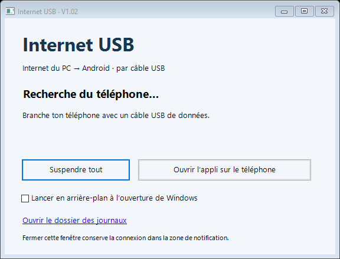

# Android Internet USB

Partager la connexion Internet d’un PC Windows avec un téléphone Android par câble USB.

**[Télécharger la version 1.02](https://github.com/da23real/android-internet-usb/releases/latest)** : l’archive ZIP contient le logiciel Windows, ses outils et l’application Android. L’APK est également disponible séparément.

## 1 — Installation

1. Télécharger et extraire entièrement `Android-Internet-USB-1.02.zip` dans un dossier où tu peux écrire. Garder `InternetUSB.exe` et le dossier `Tools` ensemble.
2. Installer `InternetUSB-1.02.apk` sur le téléphone. Android peut demander d’autoriser l’installation depuis la source utilisée.
3. Activer les options pour développeurs et le débogage USB sur le téléphone. Brancher un câble USB de données et autoriser ce PC sur l’écran du téléphone. Un pilote USB du fabricant peut être nécessaire sous Windows.
4. Lancer `InternetUSB.exe` sur le PC. Brancher un seul téléphone USB à la fois.
5. Ouvrir **Internet USB** sur Android, reprendre l’application si elle est suspendue, activer **Internet du PC par USB** et accepter l’autorisation VPN Android.

Le logiciel Windows doit rester lancé. Fermer sa fenêtre le conserve dans la zone de notification ; son menu permet de quitter. Le démarrage avec Windows est facultatif.

## 2 — Fonctions

- Internet du PC vers Android via USB, avec reconnexion automatique et test HTTPS depuis le VPN.
- Sélection charge, transfert de fichiers ou MIDI depuis l’application Android, appliquée par le compagnon Windows lorsque le téléphone l’autorise.
- Suspension globale et reprise depuis Windows ou Android.
- Erreurs conservées dans `Logs/errors.log` côté Windows et dans le stockage privé de l’application côté Android.

Le transfert de fichiers MTP classique fonctionne sans ce logiciel : choisir le mode dans Android puis utiliser l’Explorateur Windows. Le compagnon est nécessaire pour partager Internet et appliquer les demandes de mode émises par notre application.

## 3 — Compatibilité et limites

Version prototype française. Windows 64 bits avec .NET Framework 4.x. Android minimum déclaré : 6.0 (API 23), cible Android 9 (API 28). **Installation et fonctionnement matériel validés sur Huawei Y5 AMN-LX1, Android 9 uniquement.** Les autres téléphones peuvent désormais être détectés sans modifier les sources, mais leur compatibilité n’est pas garantie, notamment sur les Android récents.

Un seul téléphone USB à la fois ; ADB par Wi-Fi et émulateurs exclus. En cas de plusieurs appareils USB, débrancher les autres. Aucun numéro de téléphone ou numéro de série personnel n’est intégré.

Le mode charge conserve ADB pour maintenir le partage Internet. Les commandes de mode USB peuvent être refusées par certains fabricants : utiliser alors les réglages Android. Aucun accès root n’est demandé.

Transport IPv4 TCP/UDP via Gnirehtet ; pas d’IPv6 ni d’ICMP (`ping`). Un seul VPN Android peut être actif. Le test Internet contacte `https://www.google.com/generate_204` ; les DNS configurés sont Cloudflare et Google. Aucun service distant propre à ce projet n’est nécessaire. Le partage réseau Windows ICS n’est pas utilisé.

## 4 — Sources et compilation

Sources V1.02 dans `V1/V1.02/Sources`, dérivées de la V1.01 privée. Modifications V1.02 : détection USB générique, suppression des commandes différées entre téléphones, libellés Android génériques et signature configurée par variables d’environnement.

Outils employés : JDK 17, Gradle 8.9, Android Gradle Plugin 8.7.3, SDK Android 35 et compilateur C# .NET Framework Windows. Installer ces outils, définir `JAVA_HOME` et `ANDROID_HOME`, mettre Gradle dans le PATH, puis lancer `V1/V1.02/Sources/Build.ps1`. Les chemins de Gradle et du SDK peuvent être passés avec les paramètres `-Gradle` et `-Sdk`.

Sans configuration de signature, la compilation produit une APK **non signée**, non installable en l’état. Pour signer avec ta propre clé, définir `INTERNETUSB_KEYSTORE` (chemin absolu), `INTERNETUSB_STORE_PASSWORD`, `INTERNETUSB_KEY_ALIAS` et `INTERNETUSB_KEY_PASSWORD` dans l’environnement du processus de compilation. Les clés de publication et leurs mots de passe ne sont pas distribués. Une APK signée avec une autre clé ne peut pas mettre à jour directement l’APK officielle.

La compilation produit l’EXE et l’APK ; pour utiliser l’EXE, conserver le dossier `Tools` fourni dans la release. Les sorties de compilation et les journaux vont dans les dossiers de la version et sont exclus de Git.

## 5 — Provenance et licences

Le moteur Android est dérivé de **Genymobile Gnirehtet 2.5.1**, sous licence Apache 2.0. Les mentions de copyright d’origine sont conservées. Les sources de ce dépôt sont distribuées sous cette même licence : voir `LICENSE` et `NOTICE`.

Le relais `gnirehtet.exe` 2.5.1 est distribué sans modification. ADB et ses DLL proviennent des Android SDK Platform Tools ; leurs mentions sont dans `Tools/NOTICE-Android.txt`. Ces composants conservent leurs licences respectives.

Les sommes SHA-256 des fichiers distribués figurent dans chaque release.
